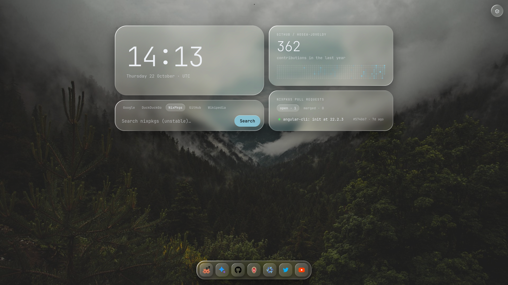
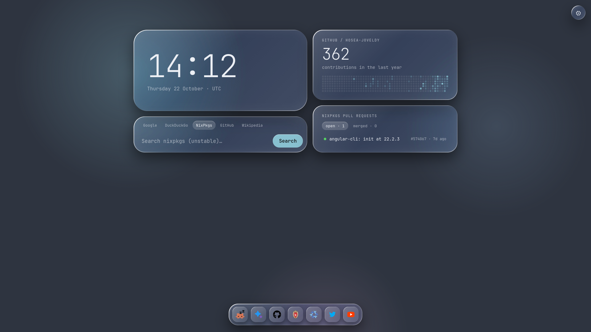

# Lumitab

Lumitab is a Firefox new-tab extension that is suitable for nix/nixos users, especially those who contribute to nixpkgs.

## Themes

<strong>Solar</strong> — complete. An animated 3D solar system, clock, Google and NixOS package search, settings, and optional GitHub and nixpkgs stats.

 

<strong>Glass</strong> — complete. A frosted-glass startpage with clock, multi-engine search, settings, quick dock, and optional GitHub and nixpkgs stats.

 

The theme implementations live in `solar/` and `glass/`.

## License

This repo is licensed under the [MIT License](LICENSE).
