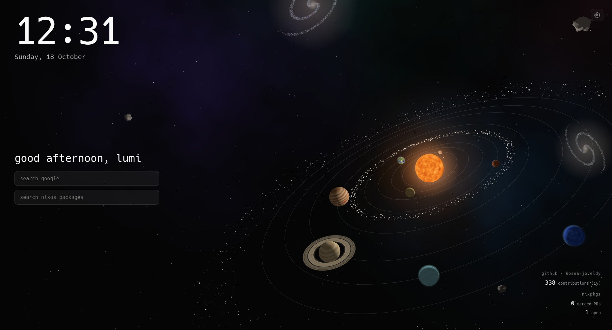

# Lumitab Solar

A lightweight Firefox new-tab extension with a live clock, Google and NixOS package search boxes, and an animated 3D solar system. It also displays GitHub contribution and nixpkgs pull request stats.

## Features

- Time, date, and greeting
- Google and NixOS package search
- Animated solar system with planet labels, stars, and pointer parallax
- GitHub contribution count and merged/open nixpkgs PR stats
